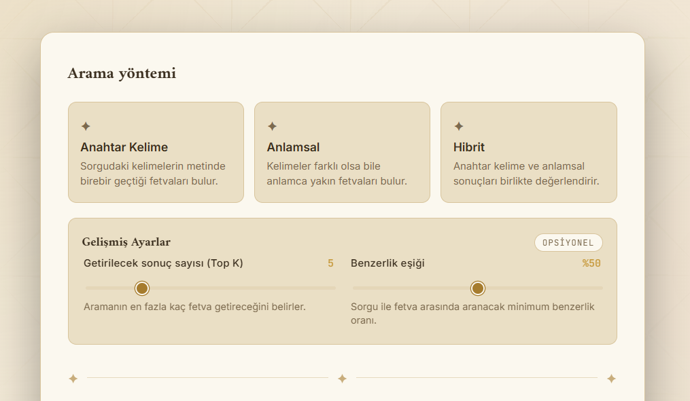
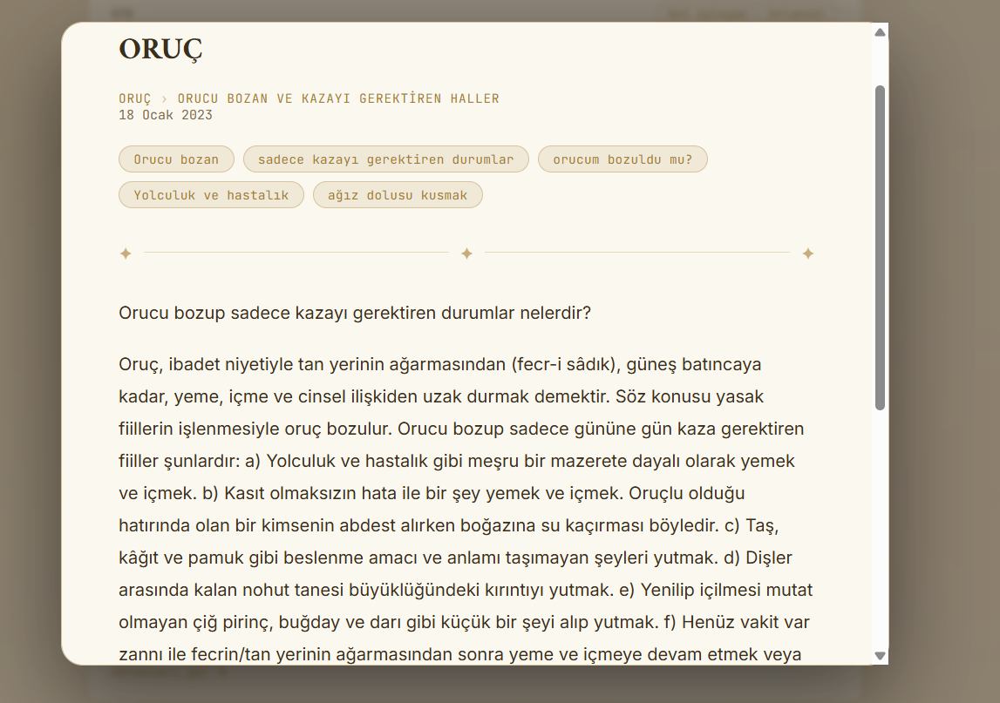

# Fetva RAG Sistemi

Fetva kaynaklarını indeksleyen ve soruları kaynak metne dayanarak yanıtlayan RAG (Retrieval-Augmented Generation) tabanlı bilgi erişim sistemi. Diyanet İşleri Başkanlığı'ndaki stajım kapsamında geliştirdim.


> **Not:** Proje kurum içinde geliştirildiği için kaynak kod bu repoda paylaşılmamaktadır. Bu sayfa sistemin ne yaptığını, mimarisini ve arayüzünü tanıtır.

## Problem

Dini sorularda dil modelinin kendi başına cevap üretmesi risklidir: model, kaynakta olmayan bir hükmü varmış gibi sunabilir. Cevabın mutlaka yetkili kaynağa dayanması ve kullanıcının o kaynağı görebilmesi gerekir.

## Çözüm

- **Kaynağa dayalı yanıt:** Fetva metinleri indekslenir; yanıtlar yalnızca getirilen kaynak metne dayandırılır. Böylece modelin kaynak dışı cevap üretme riski azalır.
- **Üç arama yöntemi:**
  - **Anahtar Kelime:** Sorgudaki kelimelerin metinde birebir geçtiği fetvaları bulur.
  - **Anlamsal:** Kelimeler farklı olsa bile anlamca yakın fetvaları bulur.
  - **Hibrit:** İki yöntemin sonuçlarını birlikte değerlendirir.
- **Ayarlanabilir erişim:** Getirilecek sonuç sayısı (Top K) ve benzerlik eşiği kullanıcı tarafından belirlenebilir.
- **Şeffaf sonuçlar:** Her sonuç eşleşme yüzdesi, kategori, etiketler, tarih ve kaynak bağlantısıyla birlikte gösterilir.
- **Dağıtıma hazır:** Sistem FastAPI ile servis haline getirilmiş ve Docker ile konteynerize edilmiştir.

## Nasıl Çalışır

```
Fetva kaynakları ──► Temizleme ──► İndeksleme
                                       │
Kullanıcı sorusu ──► Arama (anahtar kelime / anlamsal / hibrit)
                                       │
                                       ▼
                  En ilgili fetvalar (Top K, benzerlik eşiği)
                                       │
                                       ▼
                    Kaynak metne dayalı yanıt + kaynak bağlantısı
```

## Ekran Görüntüleri

**Arama yöntemi ve gelişmiş ayarlar**



**Soru girişi**


**Sonuçlar**

"Neler orucu sakatlamaya sebep olur" sorusunda "sakatlamak" kelimesi kaynaklarda geçmediği hâlde anlamsal arama, orucu bozan durumlarla ilgili fetvaları bulur.


**Fetva detayı ve kaynak**

Her fetva kategorisi, etiketleri ve tarihiyle açılır; metnin sonunda dayandığı kaynak ve bağlantısı yer alır.




## Teknolojiler

| Alan | Araçlar |
| --- | --- |
| Bilgi erişimi | RAG, anahtar kelime + anlamsal + hibrit arama |
| Dil işleme | Python, NLP |
| Backend | FastAPI |
| Dağıtım | Docker |

## İletişim

Azra Dinler · [GitHub](https://github.com/azradnlr06)
