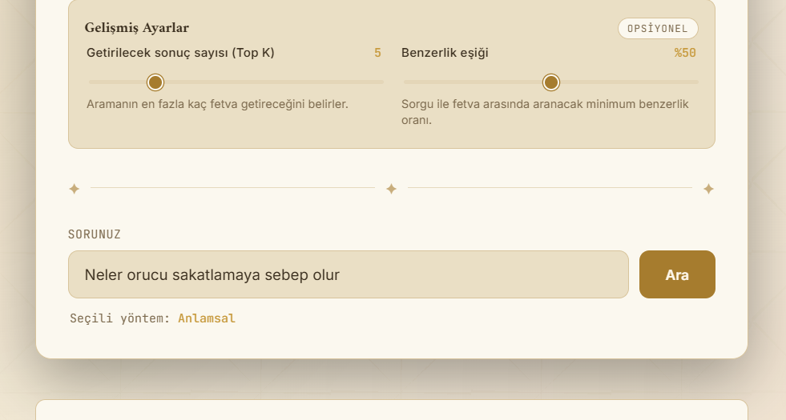
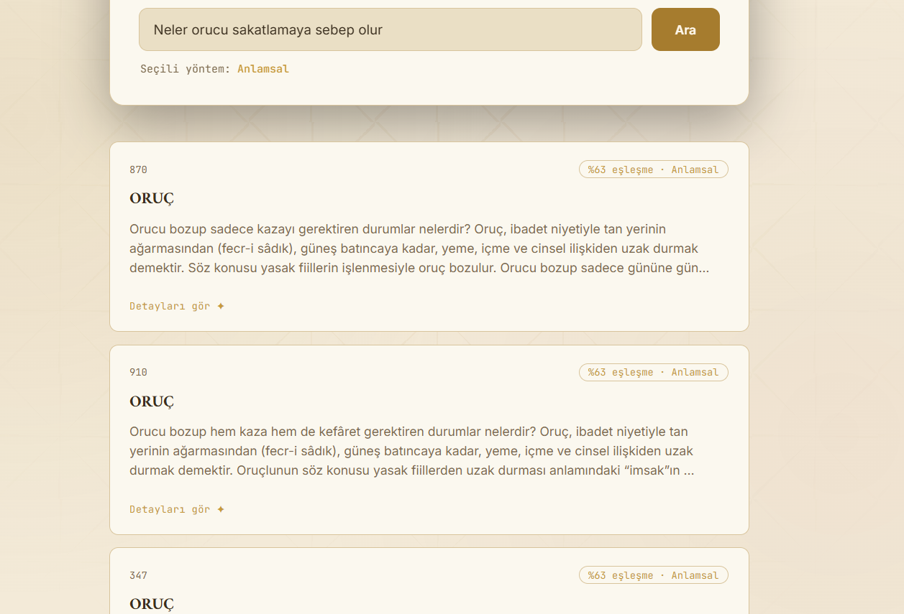
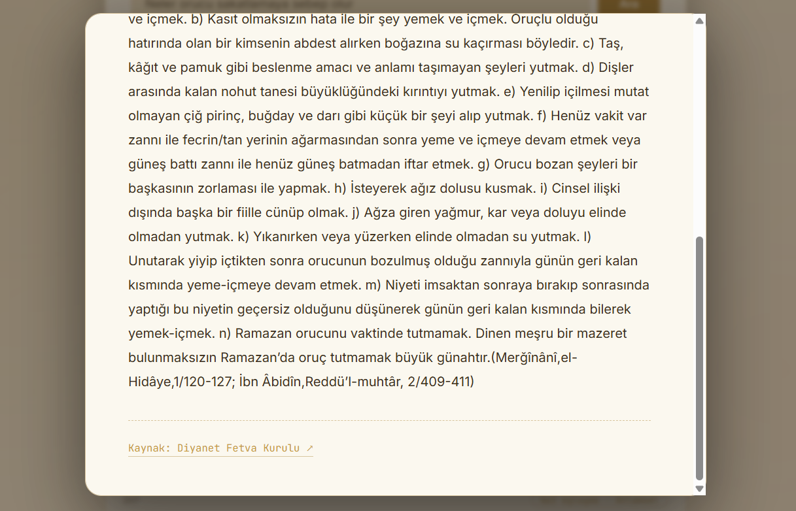

# Fetva RAG Sistemi

Fetva kaynaklarını indeksleyen ve kullanıcının sorusuna en uygun fetvaları kaynağıyla birlikte getiren, RAG (Retrieval-Augmented Generation) mimarisinin bilgi erişim katmanı. Diyanet İşleri Başkanlığı'ndaki stajım kapsamında geliştirdim.


## Problem

Dini sorularda dil modelinin kendi başına cevap üretmesi risklidir: model, kaynakta olmayan bir hükmü varmış gibi sunabilir. Cevabın mutlaka yetkili kaynağa dayanması ve kullanıcının o kaynağı görebilmesi gerekir.

## Çözüm

- **Kaynağa dayalı sonuç:** Sistem cevap uydurmaz; indekslenmiş fetva metinlerinden en ilgili olanları getirir ve her birini kaynak bağlantısıyla gösterir.
- **Üç arama yöntemi:**
  - **Anahtar Kelime:** BM25 ile sorgudaki kelimelerin metinde geçtiği fetvaları bulur.
  - **Anlamsal:** `BAAI/bge-m3` gömmeleriyle, kelimeler farklı olsa bile anlamca yakın fetvaları bulur.
  - **Hibrit:** İki yöntemin aday listelerini RRF (Reciprocal Rank Fusion) ile birleştirir.
- **Ayarlanabilir erişim:** Getirilecek sonuç sayısı (Top K) ve benzerlik eşiği kullanıcı tarafından belirlenir.
- **Şeffaf sonuçlar:** Her sonuç eşleşme yüzdesi, kategori, etiketler, tarih ve kaynak bağlantısıyla birlikte gösterilir.
- **Ölçülmüş başarı:** Üç yöntem aynı test setiyle karşılaştırılmıştır (aşağıda).

## Mimari

```
Fetva verisi (JSON)
      │  chunking_rag.py      paragraf/cümle sınırlarına saygılı, 512 token, %15 örtüşme
      ▼
Chunk'lar
      │  embedding_rag.py     dense (bge-m3, 1024 boyut) + sparse (BM25)
      ▼
Qdrant koleksiyonu
      │  retrieval/           anahtar kelime · anlamsal · hibrit (RRF)
      ▼
FastAPI  (/api/search, /api/fetva/{id})
      │
      ▼
Next.js arayüzü
```

## Değerlendirme

24 konu başlığından dengeli örneklemle seçilen 108 fetva için, orijinal sorudan farklı kelimelerle yazılmış kullanıcı soruları hazırlandı. Her yöntemin doğru fetvayı ilk 4 sonuç içinde getirip getirmediği ölçüldü.

| Metrik | Anlamsal | Anahtar Kelime | Hibrit |
| --- | --- | --- | --- |
| MRR | **0,991** | 0,794 | 0,938 |
| Hit Rate@1 | **%99,1** | %73,2 | %88,9 |
| Hit Rate@3 | **%99,1** | %87,0 | **%99,1** |
| Hit Rate@4 | **%99,1** | %88,0 | **%99,1** |
| Hiç bulunamayan soru | 1 | 13 | 1 |

Anlamsal arama, kullanıcı kaynaktakinden farklı kelimeler kullandığında anahtar kelime aramasının kaçırdığı 12 soruyu doğru yanıtladı.

## Ekran Görüntüleri

**Arama yöntemi ve gelişmiş ayarlar**


**Soru girişi**



**Sonuçlar**

"Neler orucu sakatlamaya sebep olur" sorusunda "sakatlamak" kelimesi kaynaklarda geçmediği hâlde anlamsal arama, orucu bozan durumlarla ilgili fetvaları bulur.



**Fetva detayı ve kaynak**




## Proje Yapısı

```
├── chunking_rag.py            # Fetvaları chunk'lara böler
├── test_seti.py               # Konu bazlı dengeli test seti üretir
├── sonuçlar.py                # Test sorularını üç yöntemle çalıştırır
├── metrik_hesaplama.py        # MRR, Hit Rate, Precision hesaplar ve raporlar
├── requirements-eval.txt
├── backend/
│   ├── embedding_rag.py       # Chunk'ları gömer ve Qdrant'a yazar
│   ├── requirements.txt
│   ├── app/                   # FastAPI uygulaması (main, config, schemas, utils)
│   └── retrieval/             # Anahtar kelime, anlamsal ve hibrit arama
└── frontend/                  # Next.js arayüzü
```

## Veri

Fetva metinleri, vektör veritabanı ve değerlendirme dosyaları bu repoda yer almaz. Sistemi çalıştırmak için her kaydı şu alanları içeren bir JSON listesi gerekir: `Soru`, `Cevap`, `Ana Başlık`, `Alt Başlık`, `Tarih`, `Link`, `Anahtar Kelimeler`.

## Kurulum

1. Qdrant'ı başlatın:
   ```bash
   docker run -p 6333:6333 qdrant/qdrant
   ```
2. Backend kütüphanelerini yükleyin:
   ```bash
   pip install -r backend/requirements.txt -r requirements-eval.txt
   ```
3. Veriyi chunk'lara bölün:
   ```bash
   python chunking_rag.py diyanet_fetvalari.json backend/chunked_output.json
   ```
4. Chunk'ları indeksleyin (`backend` klasöründe):
   ```bash
   python embedding_rag.py
   ```
5. API'yi başlatın (`backend` klasöründe):
   ```bash
   uvicorn app.main:app --reload
   ```
6. Arayüzü başlatın (`frontend` klasöründe):
   ```bash
   npm install
   ```
   ```bash
   npm run dev
   ```
7. Tarayıcıda `http://localhost:3000` adresini açın.

Ayarlar için `backend/.env.example` ve `frontend/.env.example` dosyalarını `.env` / `.env.local` olarak kopyalayabilirsiniz.

## API

| Yöntem | Adres | Açıklama |
| --- | --- | --- |
| GET | `/api/search?q=...&mode=hybrid&top_k=5&threshold=0.5` | Arama (`mode`: `keyword`, `semantic`, `hybrid`) |
| GET | `/api/fetva/{kayit_id}` | Fetvanın tam metni ve kaynağı |
| GET | `/health` | Servis durumu |

## İletişim

Azra Dinler · [GitHub](https://github.com/azradnlr06)
